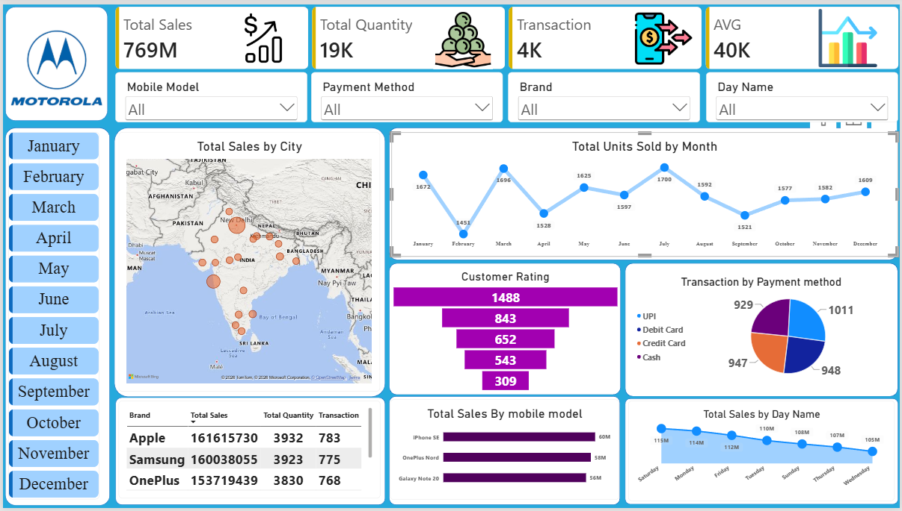

# 📱 Sales Analysis Dashboard

## 📌 Project Overview
This project analyzes Motorola mobile sales data using Microsoft Power BI. The dashboard provides insights into sales performance, transactions, product demand, payment preferences, customer ratings, and geographical sales distribution.


## 📸 Dashboard Preview

 [Dashboard Preview](Motorola-Dashboard.png)


## 🎯 Key Performance Indicators (KPIs)
- **Total Sales:** 769M
- **Total Quantity Sold:** 19K
- **Total Transactions:** 4K
- **Average Sales:** 40K

## 📊 Dashboard Features
### 1. Sales Performance Analysis
- Monthly trend of units sold.
- Sales comparison across days of the week.
- Overall sales and transaction performance.

### 2. Geographical Sales Analysis
- City-wise sales distribution.
- Geographical visualization of mobile sales.

### 3. Product & Brand Analysis
- Brand-wise sales comparison.
- Sales by mobile model.
- Identification of top-performing models.

### 4. Customer & Payment Analysis
- Customer rating distribution.
- Transaction analysis by payment method: UPI, Debit Card, Credit Card, and Cash.

## 🔍 Key Observations
- Total sales reached **769M**, with approximately **19K units sold** across **4K transactions**.
- March recorded the highest monthly unit sales, while February recorded the lowest.
- Saturday generated the highest sales among the days shown.
- UPI was the most frequently used payment method.
- Apple recorded the highest sales among the brands displayed.
- iPhone SE was the top-performing mobile model among the models displayed.

## 🛠️ Tools & Technologies
- Microsoft Power BI
- Power Query
- DAX
- Data Cleaning & Transformation
- Data Modeling
- Data Visualization

## 📷 Dashboard Preview


## 📁 Project Structure
```text
Motorola-Mobile-Sales-Analysis/
├── README.md
├── Dashboard/
│   └── Add-your-Power-BI-file.pbix
├── Dataset/
│   └── Add-your-dataset.xlsx
└── Screenshots/
    └── Motorola-Dashboard.png
```

## 👨‍💻 Created By
**Jitendra Kumar**

Power BI | Data Analytics | SQL | Excel

---
⭐ If you find this project useful, feel free to explore the repository and share your feedback!
